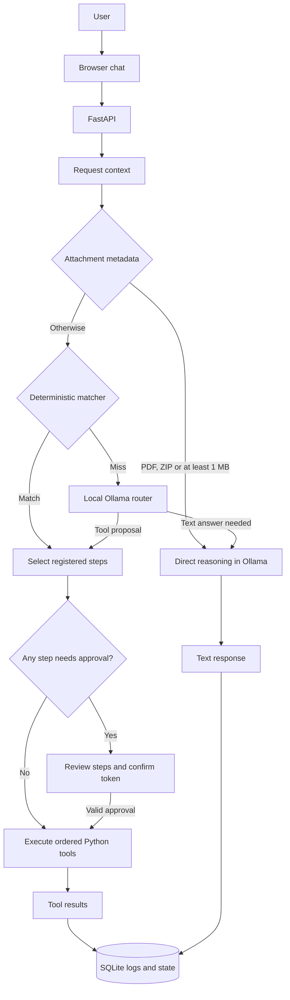

# ATLAS — Local AI Assistant & Tool-Orchestration System

ATLAS connects everyday requests to inspectable actions on a Mac. Ask which files import a module and a Python tool can read the repository and return the dependencies it found. Ask for the battery level and an ordinary function can answer without loading a language model.

## Why ATLAS exists

The project grew out of an interest in running useful local AI on a fanless MacBook Air with 16 GB of unified memory. A model shares that memory with the editor, browser and operating system. ATLAS uses ordinary code where the request is predictable, calls a local model when language needs interpretation, and records enough of the outcome to test whether that choice helped.

## From request to result



L0 identifies a pattern match, L2 a routed single step, L3 a routed sequence and L4 direct reasoning. L1 has no separate execution branch. The router and direct reasoning both default to `qwen3:4b-instruct`. Attachment metadata can select L4, which receives the request text. Reading file contents requires a tool and an accessible local path. [Request handler](ATLAS-GitHub/main.py) · [Routing rules](ATLAS-GitHub/decision_engine.py)

## Four requests you can trace

| Request | What happens |
|---|---|
| “What's my battery?” | The matcher selects `get_battery`. Python queries `psutil` for the percentage and charging state, or reports that a reading is unavailable. The integration tests supply the hardware reading. |
| “What imports this module?” | Given a project directory and focus file, `dependency_graph` parses Python imports and recognizes common JS/TS import patterns. Each resolved internal import adds an edge. An iterative depth-first search looks for cycles. |
| “Rename draft.md to notes.md.” | If the router proposes `rename_file`, FastAPI returns the proposed arguments and a five-minute token. Confirmation of the same steps consumes the token before execution. |
| “Summarize this local document.” | Given a supported path, `summarize_document` extracts text and sends up to the first 40,000 characters plus instructions to Ollama. Content beyond that excerpt falls outside the summary. |

## Tool capabilities

| Area | Registered names |
|---|---|
| Desktop and processes | `open_app`, `open_url`, `play_youtube_video`, `get_battery`, `open_project`, `run_localhost`, `run_shell_command` |
| Repository and archives | `index_project`, `dependency_graph`, `git_query`, `search_code`, `read_zip` |
| Files and clipboard | `read_file`, `copy_file`, `move_file`, `rename_file`, `delete_file`, `read_clipboard`, `write_clipboard` |
| Summaries and retrieval | `summarize_document`, `summarize_youtube_video`, `search_knowledge` |
| Unfinished integrations | `send_email`, `get_stock_price` |

Of the 24 names, 22 have substantive implementations. Some depend on macOS utilities, installed programs or external transcript availability. [Tool registry](ATLAS-GitHub/tools.py) · [Technical FAQ](ATLAS-GitHub/docs/project-guide/TECHNICAL_FAQ.md)

## Design decisions

Python puts file access, AST parsing and tool dispatch in one process. FastAPI exposes those functions to the browser, while SQLite keeps conversations, summaries, approvals and job progress in a local file. The background API can execute an ordered plan and report progress between steps. Ollama provides local inference through HTTP. Deterministic matching avoids that call for familiar phrases, and confirmation tokens bind approval to a particular proposal. [Design decisions and tradeoffs](ATLAS-GitHub/docs/project-guide/DESIGN_DECISIONS.md)

## Testing and benchmark evidence

**355 original cases passed in an isolated rerun on November 19, 2026.** After 23 regression cases were added, **378 of 378 passed in a hosted macOS GitHub Actions run**. The suite exercises real temporary files, Git repositories, SQLite and in-process HTTP. It substitutes model replies, external services and selected hardware operations. [Hosted run](https://github.com/vedpatel-real-ai/ATLAS_Personal_AI_Assistant-System/actions/runs/44576110069) · [Test records](ATLAS-GitHub/evidence/tests/2026-11-19/) · [Test inventory](ATLAS-GitHub/docs/verification/TEST_VERIFICATION.md)

- **July document experiment.** The tool path sent 40,181 prompt characters versus 140,837, about 71.5% fewer. Both paths reported 2,050 evaluated prompt tokens. The shorter prompt took 61.63 seconds versus 52.37 seconds. The report establishes neither a token reduction nor a general speed advantage. Its original raw captures were unavailable. [July report](ATLAS-GitHub/docs/benchmark-report.md)
- **November model experiment.** Both 4B and 8B tags were installed. One 4B warm-up completed before memory pressure rose to warning. The run stopped with zero measured paired trials, leaving the model-selection question open. [Raw observation](ATLAS-GitHub/evidence/benchmarks/2026-11-19/raw-results.json) · [Benchmark verification](ATLAS-GitHub/docs/verification/BENCHMARK_VERIFICATION.md)

## Project Background & Development

ATLAS is a personal AI-engineering learning project. Its owner set out to explore useful local AI, resource-conscious execution and ways to measure the results. Development involved substantial AI-assisted coding. A coding agent carried out the recent verification work and engineering corrections. The source, test transcripts and benchmark records are available for independent inspection.

## Getting started

On macOS with Git, Python 3.12 and Ollama installed, open Ollama and list the models already on your machine.

```sh
git clone https://github.com/vedpatel-real-ai/ATLAS_Personal_AI_Assistant-System.git
cd ATLAS_Personal_AI_Assistant-System/ATLAS-GitHub
python3.12 -m venv venv
. venv/bin/activate
python -m pip install -r requirements-test.txt
ollama list
```

If your installed instruction model has a different tag than `qwen3:4b-instruct`, set the three model constants listed in the [application setup guide](ATLAS-GitHub/README.md#select-an-installed-model). Then start ATLAS and use the **API key** button at `http://127.0.0.1:8420/` to enter the value from the generated local file `.secrets/api_key`.

```sh
bash start.sh
# Run the isolated suite from this same application directory.
python -m pytest -q tests
```

## Project status

ATLAS is experimental, single-user macOS software. Tools run with the local account’s permissions. The planner executes ordered steps and supports cancellation between steps. Restarting marks interrupted jobs failed. Live service reliability, routing accuracy and summary quality need separate evaluation. [Examples and limitations](ATLAS-GitHub/docs/project-guide/EXAMPLES_AND_LIMITATIONS.md)

## Documentation

- [How it works](ATLAS-GitHub/docs/project-guide/HOW_IT_WORKS.md) · [Technical FAQ](ATLAS-GitHub/docs/project-guide/TECHNICAL_FAQ.md) · [Design decisions](ATLAS-GitHub/docs/project-guide/DESIGN_DECISIONS.md)
- [Test verification](ATLAS-GitHub/docs/verification/TEST_VERIFICATION.md) · [Benchmark verification](ATLAS-GitHub/docs/verification/BENCHMARK_VERIFICATION.md) · [Source-code verification](ATLAS-GitHub/docs/verification/CLAIM_MATRIX.md)
- [Full application guide](ATLAS-GitHub/README.md) · [MIT license](ATLAS-GitHub/LICENSE)
